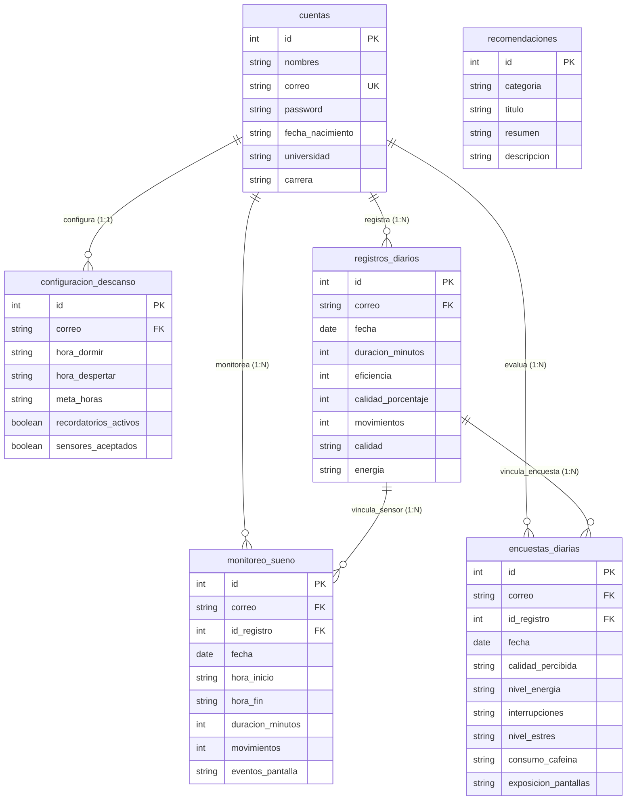

# 🌙 SleepTrack App - Guía Completa de la Aplicación

**SleepTrack** es una aplicación Android nativa desarrollada en **Java** y **XML**, diseñada inspirándose en la experiencia de usuario y algoritmos de análisis de **Sleep Cycle** y bajo los principios de diseño de **Apple (Human Interface Guidelines)**: tarjetas suaves con sombras sutiles, esquinas altamente redondeadas (`16dp`-`24dp`), barra de navegación inferior con indicador de píldora activa, encuestas diarias basadas en emojis y radio-botones interactivos, y lectura de acelerómetro en tiempo real.

---

## 🚀 Arquitectura y Tecnologías
- **Lenguaje**: Java 17 (Nativo Android).
- **Diseño**: XML con Material Design 3 y estilo iOS (Tarjetas elevadas `MaterialCardView`, `BottomNavigationView` estilo píldora).
- **Red & API**: Volley HTTP comunicándose con el servidor local XAMPP (`http://192.168.3.225/SLEEPTRACKAPP/api/`).
- **Base de Datos**: MySQL en XAMPP (`sleeptrack`) con sentencias preparadas y migración automática.
- **Sensores Nativos**: `SensorManager` y `Sensor.TYPE_ACCELEROMETER` para la detección en tiempo real de movimientos corporales durante el sueño.
- **Persistencia Local**: `SharedPreferences` para caché de sesión y almacenamiento de cero latencia.

---

## 📱 Agrupación Oficial de Pantallas e Historias de Usuario (HU-01 a HU-23)

Para mantener una arquitectura modular, escalable y sin redundancias de actividades, las 23 Historias de Usuario oficiales se agrupan en las siguientes pantallas:

| Sección / Pantalla | Archivo Layout XML | Clase Java Principal | Historias de Usuario Cubiertas |
| :--- | :--- | :--- | :--- |
| **Bienvenida** | `activity_hu01_bienvenida.xml` | `BienvenidaActivity` | **HU-01**: Conocer SleepTrack y navegar a Registro/Login (con auto-login). |
| **Crear Perfil** | `activity_hu02_crear_perfil.xml` | `CrearPerfilActivity` | **HU-02**: Registro de datos personales, académicos y credenciales. |
| **Iniciar Sesión** | `activity_hu03_iniciar_sesion.xml` | `IniciarSesionActivity` | **HU-03**: Autenticación de usuario. **HU-04**: Recuperación de contraseña por Correo y Fecha de Nacimiento (`dialog_hu04_recuperar_password.xml`). |
| **Consentimiento** | `activity_hu05_consentimiento_monitoreo.xml` | `ConsentimientoActivity` | **HU-05**: Información y aceptación de sensores y almacenamiento. |
| **Configuración** | `activity_hu06_configurar_descanso.xml` | `ConfigurarDescansoActivity` | **HU-06**: Horarios objetivo, meta personal y recordatorios. |
| **Monitoreo** | `activity_hu07_hu08_monitoreo.xml` | `MonitoreoActivity` | **HU-07**: Iniciar sesión de monitoreo con acelerómetro. **HU-08**: Cronómetro en tiempo real, contador de movimientos, finalización y sincronización. |
| **1. Inicio (Dashboard)** | `activity_hu12_hu13_hu14_resumen_descanso.xml` | `ResumenDescansoActivity` | **HU-12**: Resumen del descanso, calidad y eficiencia. **HU-13**: Línea de tiempo nocturna segmentada. **HU-14**: Recomendaciones educativas vinculadas. |
| **2. Historial** | `activity_hu17_hu18_historial_mensual.xml` `activity_hu15_hu16_analisis_semanal.xml` | `HistorialMensualActivity` `AnalisisSemanalActivity` | **HU-15**: Resumen semanal con gráficos de barras interactivos. **HU-16**: Comparativa de hábitos semana vs. fin de semana. **HU-17**: Calendario mensual interactivo con puntos de color y detalle diario. **HU-18**: Estadísticas mensuales acumuladas. |
| **3. Registrar** | `activity_hu09_hu10_hu11_registro_diario.xml` | `RegistroDiarioActivity` | **HU-09**: Calidad percibida y energía por Emojis. **HU-10**: Factores (Estrés, Cafeína `🔘/⚪` y Pantallas `🔘/⚪`). **HU-11**: Guardado local y remoto en MySQL. |
| **4. Consejos** | `activity_hu19_hu20_recomendaciones.xml` | `RecomendacionesActivity` | **HU-19**: Recomendaciones filtrables por categoría (Horarios, Pantallas, Estrés, Cafeína). **HU-20**: Alertas de privación de sueño y logros semanales. |
| **5. Perfil** | `activity_hu21_hu22_perfil_cuenta.xml` | `PerfilCuentaActivity` | **HU-21**: Consultar perfil. **HU-22**: Cerrar sesión con diálogo de confirmación (`dialog_hu22_cerrar_sesion.xml`). **HU-23**: Privacidad y eliminación de registros (`activity_hu23_privacidad_datos.xml` y `dialog_hu23_eliminar_registros.xml`). |

---

## ⌚ Algoritmo de Monitoreo con Acelerómetro (Estilo Sleep Cycle)

En `MonitoreoActivity.java`:
- Al presionar **Iniciar monitoreo**, la app registra el sensor de **Acelerómetro** del dispositivo.
- Cada cambio brusco o movimiento físico durante la noche ($\Delta G > 2.2 m/s^2$) incrementa un contador dinámico de movimientos con antirrebote de 1.8 segundos.
- Al pulsar **Finalizar monitoreo**, la app calcula:
  - **Duración Real del Sueño** (horas y minutos).
  - **Eficiencia del Sueño (%)**: Basado en el reposo continuo.
  - **Calidad del Sueño (%)**: Evalúa el cumplimiento de la meta vs. la cantidad de movimientos detectados.
- Sincroniza inmediatamente los resultados con el backend mediante `api/guardar_monitoreo.php`.

---

## 🗄️ Base de Datos MySQL Relacional en XAMPP (`sleeptrack`)

El modelo de datos cuenta con una arquitectura relacional normalizada y ordenada basada **estrictamente en los componentes y pantallas de SleepTrack**. Todas las tablas están interconectadas mediante **Claves Foráneas (Foreign Keys InnoDB con `ON DELETE CASCADE`)**:

### Autogestión Automática (`db_connect.php`)
Los scripts PHP incluyen **autocreación y automigración transparente de Base de Datos, Tablas y Claves Foráneas**. Al conectarse, PHP asegura la integridad del esquema relacional y la sincronización con el motor InnoDB en XAMPP.

### Endpoints Backend PHP (`/SLEEPTRACKAPP/api/`)
1. `register.php`: Registro de usuarios con validación y cifrado BCrypt.
2. `login.php`: Inicio de sesión y devolución de perfil/configuración.
3. `configurar.php`: Guardado de horarios objetivo y preferencias de sensores.
4. `recuperar.php`: Restablecimiento seguro de contraseña mediante correo y fecha de nacimiento.
5. `guardar_monitoreo.php`: Persistencia de sesiones de monitoreo con acelerómetro (duración, eficiencia, calidad %, movimientos, horarios).
6. `guardar_registro.php`: Persistencia de respuestas con emojis y factores (`ON DUPLICATE KEY UPDATE`).
7. `obtener_resumen.php`: Obtiene el último registro de sueño y configuración para el Dashboard.
8. `obtener_historial.php`: Obtiene el historial con soporte de filtrado mensual y anual.
9. `obtener_analisis_semanal.php`: Desglose de 7 días (Lunes a Domingo), horas de descanso, hábitos semana vs. fin de semana y detección de irregularidades.
10. `obtener_perfil.php`: Obtiene el perfil del usuario junto a sus estadísticas históricas calculadas en tiempo real (total de noches, promedio de descanso, promedio de eficiencia).
11. `eliminar_datos.php`: Eliminación segura de registros o cuenta del usuario para cumplimiento de privacidad (HU-23).

---

## 🎨 Características de Diseño UX / UI (Apple HIG)
- **Píldora Indicadora en Navegación**: Barra inferior con 5 ítems (`Inicio`, `Historial`, `Registrar`, `Consejos`, `Perfil`), destacando la pestaña seleccionada con un fondo de píldora redondeada suave (`#E8E9FE`) e ícono morado (`#5B55FE`).
- **Gráfico de Barras Semanal Interactivo**: 7 columnas con alturas proporcionales, colores de cumplimiento verde menta y morado Apple, y feedback táctil al seleccionar cada día.
- **Calendario Mensual Interactivo**: Matriz de días con indicadores visuales por calidad de descanso y tarjeta de detalle dinámico.
- **Encuestas con Emojis e Íconos Radio**:
  - Calidad de sueño: `😫`, `😞`, `😐`, `😊`, `😁`.
  - Nivel de energía: `🪫`, `😴`, `😐`, `⚡`, `🚀`.
  - Cafeína y Pantallas: Botones de selección vertical con marcadores dinámicos `🔘` / `⚪`.
- **Diseño Limpio y Espacioso**: Tarjetas elevadas con sombra suave (`8dp-12dp`) e interacción visual táctil en tiempo real.

---

## 🛠️ Instrucciones de Ejecución
1. Abrir la carpeta `SLEEPTRACKAPP` en **Android Studio**.
2. Encender los módulos **Apache** y **MySQL** en la consola de **XAMPP**.
3. Sincronizar Gradle y compilar con `app:assembleDebug`.
4. Ejecutar la aplicación en un emulador o teléfono Android conectado.
